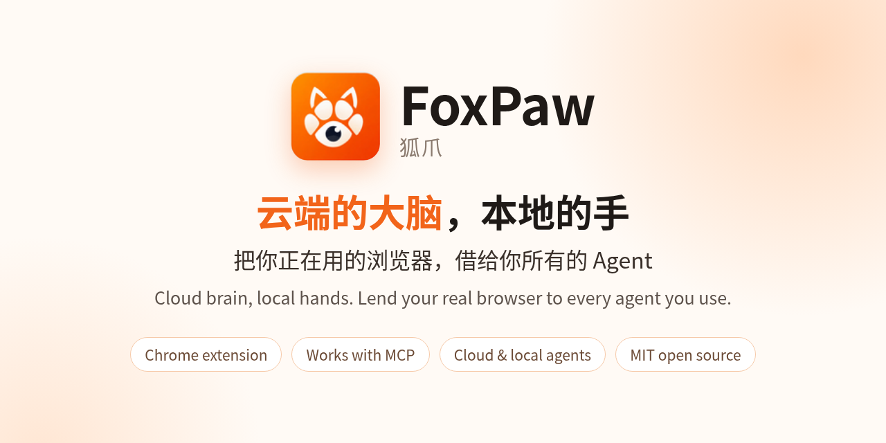
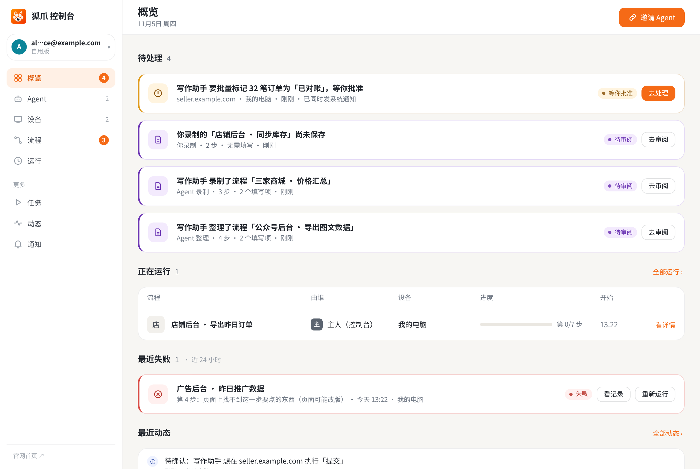
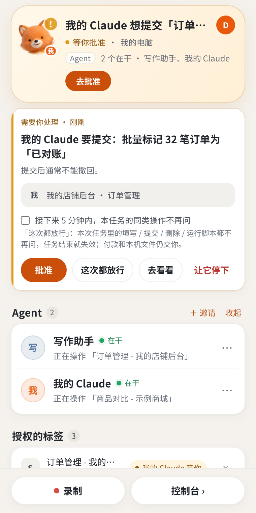
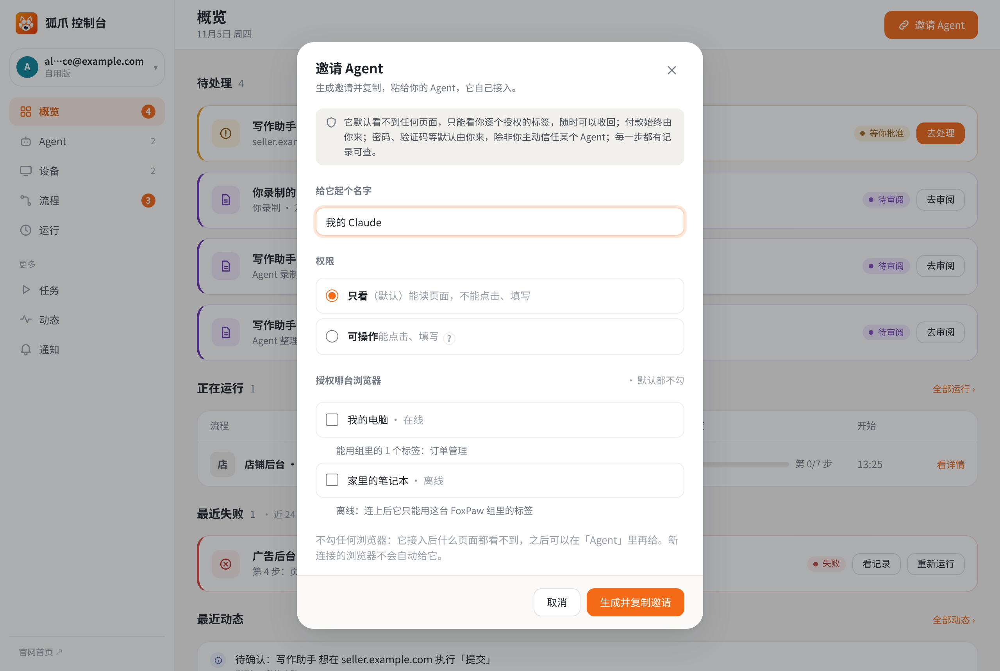

<div align="center"><a name="readme-top"></a>



<h1>FoxPaw</h1>

**Lend your real, logged-in Chrome to every agent you use, cloud or local. One browser, many agents, no new logins. Payments always wait for your approval.**

**English** · [简体中文](README.zh-CN.md) · [Website](https://foxpaw.aiyuancat.com) · [Agent guide](docs/agent-guide.md) · [Changelog](CHANGELOG.md) · [Issues](https://github.com/laomao-ai/foxpaw-extension/issues)

[](LICENSE)
[](https://github.com/laomao-ai/foxpaw-extension/releases/latest)
[](https://github.com/laomao-ai/foxpaw-extension/stargazers)
[](docs/agent-guide.md)
[](extension/)
[](https://foxpaw.aiyuancat.com)

</div>

FoxPaw is a Chrome extension. Agents running in the cloud or on your own computer — anything that speaks MCP, from hosted assistants to coding agents and IDEs — connect through a hosted relay to the real Chrome on your own machine and works only inside the tabs you hand it: reading pages, filling forms, clicking buttons, recording and replaying flows. Sites you are logged in to just work; sites you are not, it can't get into either.

<!-- Demo GIF goes here (screen recording to be added): docs/images/demo.gif, ~20 s: agent reads an order list in an authorized tab → approval card pops up → user approves. -->

## What it can do for you

| | Before | With FoxPaw |
|---|---|---|
| **Your own back-office: export, reconcile, fill in** | Log in, filter by date, page through, copy into a sheet, compare line by line. | Drag the logged-in tab into the FoxPaw tab group and say *"Read all paid orders from Nov 4 and check them against this sheet."* It pages through and reads in your tab; anything it wants to change pops up an approval card first. |
| **Across several sites: collect, compare, tabulate** | A dozen tabs, copy-paste price, specs and shipping one shop at a time. | *"Put this robot vacuum's price, specs and shipping from these three shops into one table."* Long pages are read to the end, chat widgets and "checking your browser" pages don't stall it. Slider / puzzle captchas are handed back to you. |
| **Record once, run every day** | Every weekday morning: log in, pick "yesterday", export, screenshot, post. | Demonstrate once (or let the agent do it once) and FoxPaw saves it as a flow; turn on a schedule like "weekdays 09:00". Every run is logged step by step; if a step fails it pauses and tells you which step and why. |

## See it

| Console | Sensitive actions ask you first |
|---|---|
|  |  |
| **Invite an agent: read-only, no browser granted by default** | **Website** |
|  |  |

## Quick start (30 seconds)

1. **Install the extension** — download from the [website](https://foxpaw.aiyuancat.com/download/extension) or use [`extension/`](extension/) in this repo → open `chrome://extensions` → turn on *Developer mode* → *Load unpacked* and pick the folder.
2. **Connect the browser** — in the side panel click *Connect this browser*, sign in with an email code and confirm; drag the tabs your agent may use into the FoxPaw tab group.
3. **Invite your agent** — console → *Connect agent* → generate an invite (copied automatically) → paste it to your agent. It follows the [agent guide](https://foxpaw.aiyuancat.com/docs) to claim its token and configure MCP itself.

Manual setup for each client is in [`examples/`](examples/); the core is just this:

```json
{
  "mcpServers": {
    "foxpaw": {
      "type": "http",
      "url": "https://foxpaw.aiyuancat.com/mcp",
      "headers": { "Authorization": "Bearer <token>" }
    }
  }
}
```

## Privacy and permissions

Rules built into the system, not promises:

- **Your browser stays on your machine.** Cookies and the logins you save in FoxPaw stay on your computer (saved logins are encrypted in the extension); the relay only forwards calls.
- **Payments always need your approval.** Every payment, subscription or upgrade click asks you on a card first (amount shown), every time; card numbers and payment passwords are always yours to type.
- **Passwords and verification codes are yours by default** — unless you choose to trust a specific agent with saved logins; even then the extension fills them locally and the agent only ever sees `•••`. Human-verification checks are always left to you.
- **The tab group is the boundary.** The agent can only see and act in tabs you put in the FoxPaw tab group. A newly invited agent gets no browser at all and starts read-only; you grant more per agent.
- **Ask before changing things.** Submits, deletes and authorizations pop up an approval card; *Pause all* stops every agent at once.
- **Your tokens, your control.** One token per device and per agent, stored hashed on the relay; rename, disconnect or revoke any time, effective immediately.

Browser permissions and why: `tabs` / `tabGroups` (find the authorized tab group), `scripting` / `debugger` (read and act in authorized tabs), `webRequest` (observe only, never block, to tell when a page finished loading), `storage` (local settings and encrypted saved logins), `notifications` / `sidePanel` / `alarms` / `webNavigation` / `activeTab` (side panel, reminders, navigation state). The full source is in [`extension/`](extension/) — no third-party code, no build step.

## FAQ

<details>
<summary><b>Is it free?</b></summary>

The client code is MIT-licensed and free to use and modify. The official hosted relay is free during the public beta and may have usage limits; paid plans may be introduced later with advance notice. No SLA is provided.
</details>

<details>
<summary><b>Can FoxPaw or the relay see my passwords or cookies?</b></summary>

The relay does not store them. Page actions happen in your own Chrome; cookies and the logins you save in FoxPaw stay on your machine. The relay only forwards calls and keeps permission records. An agent you choose to trust can sign in with a saved login, but the extension types it locally and the agent only sees `•••`.
</details>

<details>
<summary><b>Which agents work with it?</b></summary>

Cloud or local — any agent that speaks MCP over HTTP (or via the stdio bridge), for example hosted agents, Claude Code, Codex, Cursor or VS Code. Ready-made configs are in [`examples/`](examples/).
</details>

<details>
<summary><b>How is this different from browser automation that opens its own browser?</b></summary>

Tools that launch a fresh browser start logged out, so the agent hits login pages, SMS codes and "new device" checks. FoxPaw works in the Chrome you already use, only in the tabs you authorize, with approval cards for sensitive actions.
</details>

<details>
<summary><b>Can I self-host the relay?</b></summary>

Not at the moment: the relay server is not open source. The extension in this repo is fully open, and you can run it as an independent extension (see the note on `key` in the [Chinese README](README.zh-CN.md#关于-manifestjson-里的-key)).
</details>

## Open source and limits

- The client code is MIT-licensed and free to use and modify.
- The official hosted relay is free during the public beta and may have usage limits; paid plans may be introduced later with advance notice.
- No SLA is provided.
- The relay server is not open source at this time; it is operated by 艾元猫工作室 (Aiyuanmao Studio) at `foxpaw.aiyuancat.com`.

**Architecture in one line:** browser extension (this repo, MIT) ↔ hosted relay ↔ your agent (standard MCP). The relay only forwards and keeps permission records; page actions happen in your own browser.

## Contributing and security

- Bugs, feature requests, site compatibility: [Issues](https://github.com/laomao-ai/foxpaw-extension/issues) (templates provided). See [CONTRIBUTING.md](CONTRIBUTING.md).
- Security vulnerabilities: please don't open a public issue — report privately as described in [SECURITY.md](SECURITY.md).

## Star History

[](https://star-history.com/#laomao-ai/foxpaw-extension&Date)

<div align="right"><a href="#readme-top">Back to top ↑</a></div>
