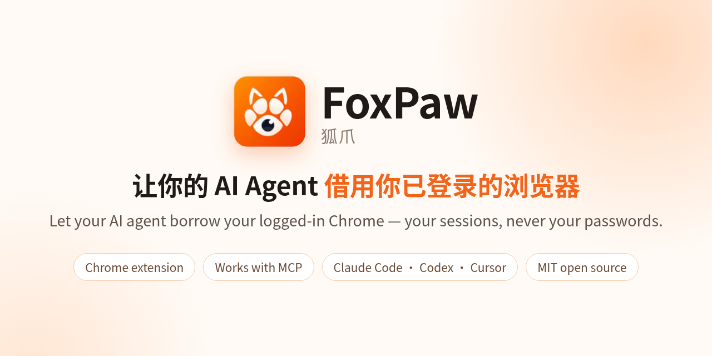
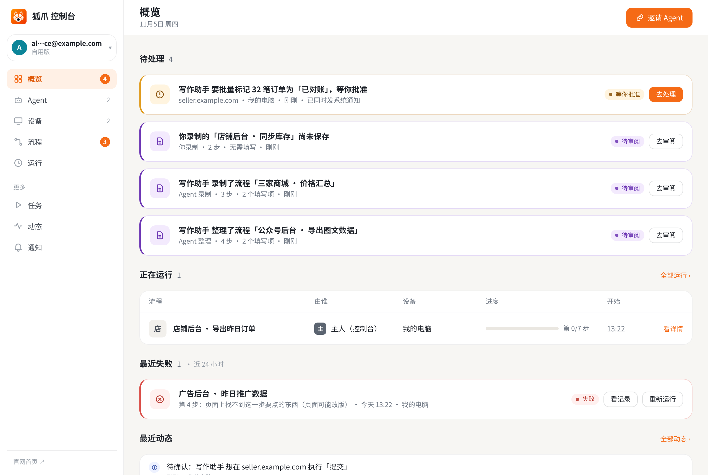
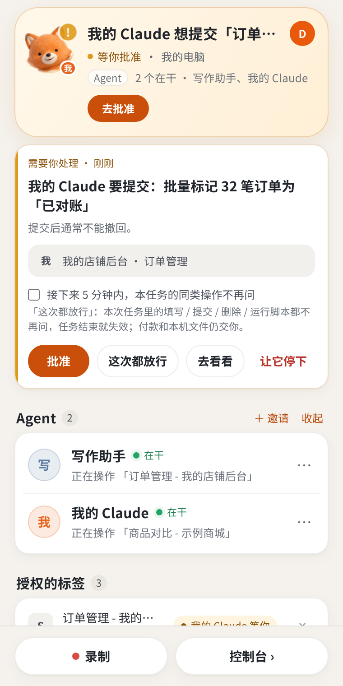
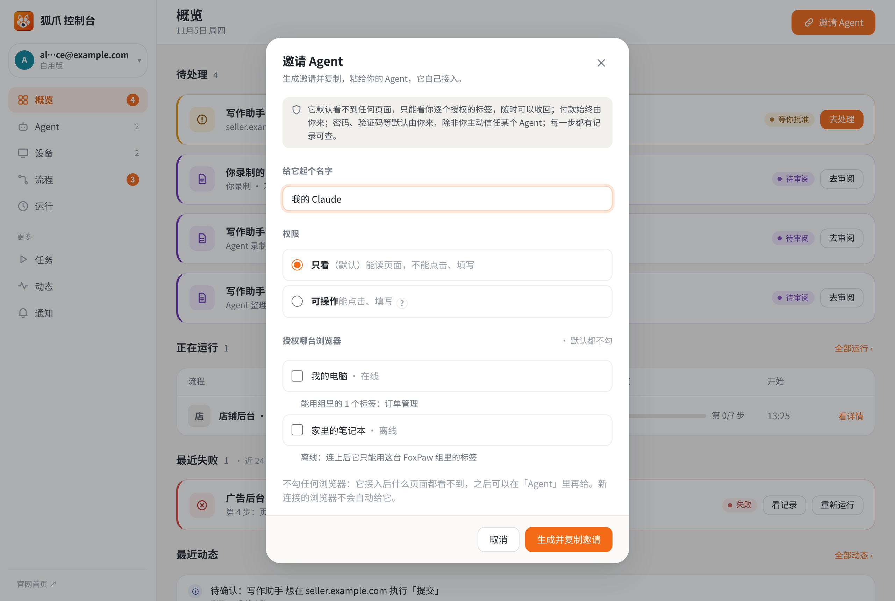

<div align="center"><a name="readme-top"></a>



<h1>FoxPaw · 狐爪</h1>

**让你的 AI Agent 借用你已登录的浏览器：借的是登录态，永远不交密码。**

[English](README.md) · **简体中文** · [官网](https://foxpaw.aiyuancat.com) · [Agent 接入说明](docs/agent-guide.md) · [更新日志](CHANGELOG.md) · [反馈](https://github.com/laomao-ai/foxpaw-extension/issues)

[](LICENSE)
[](https://github.com/laomao-ai/foxpaw-extension/releases/latest)
[](https://github.com/laomao-ai/foxpaw-extension/stargazers)
[](docs/agent-guide.md)
[](extension/)
[](https://foxpaw.aiyuancat.com)

</div>

FoxPaw 是一个 Chrome 扩展。Claude Code、Codex、Cursor，凡是支持 MCP 的 Agent 都能通过托管中继连到你本机的真实 Chrome，只在你授权的标签页里看页面、填表单、点按钮、录制和回放流程。你在哪个网站登录着，它就能在那儿干活；你没登录的，它也进不去。

<!-- 演示动图位（之后补录屏）：docs/images/demo.gif，约 20 秒：Agent 在授权标签里读订单列表 → 侧栏弹批准卡 → 你点批准。 -->

## 它能帮你做什么

| | 以前 | 现在 |
|---|---|---|
| **自己的后台：导出、对账、填表** | 登录后台，筛日期，翻页，复制到表格，再拿另一张表一行行对。 | 登录好后台，把标签拖进 FoxPaw 标签组，跟 Agent 说「把 11 月 4 日已付款的订单全读出来，跟这张表对一下」。它在你那个已登录的标签里翻页读数；要改东西（比如批量标「已对账」），先在侧栏弹卡等你批准。 |
| **跨好几个网站：收集、比价、整理成表** | 开十几个标签，一家一家复制价格、规格、运费。 | 「这款扫地机，在这三家店的价格、规格、运费，整理成一张表给我。」长页面读到结尾，在线客服挂件、「人机识别，请稍候」不再拖住它；要你拖滑块、点拼图的验证，它举手叫你。 |
| **录一次，以后每天自己跑** | 每个工作日早上登后台、选「昨天」、导出、截图发群。 | 你演示一遍（或让 Agent 照目标做一遍），存成「流程」，在控制台打开定时，比如「工作日 09:00」。每次运行一步步有记录，哪步失败就停下写清原因等你决定；开了飞书通知，失败和要你处理的事会推到手机上。 |

## 看一眼

| 控制台 | 敏感动作先问你 |
|---|---|
|  |  |
| **邀请 Agent：默认只看、不授权任何浏览器** | **官网** |
|  |  |

## 30 秒上手

1. **装扩展**：从 [官网下载](https://foxpaw.aiyuancat.com/download/extension) 或用本仓库 [extension/](extension/) 目录 → 打开 `chrome://extensions` → 右上角开「开发者模式」→「加载已解压的扩展程序」选中文件夹。
2. **连浏览器**：点扩展侧栏「连接这台浏览器」，用邮箱验证码登录并确认；把要给 Agent 用的标签拖进 FoxPaw 标签组。
3. **邀请 Agent**：控制台「接入 Agent」→ 生成邀请（自动复制）→ 粘给你的 Agent。它会照 [接入说明](https://foxpaw.aiyuancat.com/docs) 自己领令牌、配好 MCP。

需要手动配置时，各客户端写法见 [examples/](examples/)，核心就两样：

```json
{
  "mcpServers": {
    "foxpaw": {
      "type": "http",
      "url": "https://foxpaw.aiyuancat.com/mcp",
      "headers": { "Authorization": "Bearer <token>" }
    }
  }
}
```

## 隐私与授权

写进系统里的规矩，不是口头承诺：

1. **借登录态，不交密码**：密码和 Cookie 不离开你的电脑。
2. **付款始终由你来**：卡号、支付密码、付款那一步，一律交回给你。
3. **密码、验证码等默认由你来，除非你主动信任某个 Agent**：信任后它才能用你存的登录凭证登录，此时也由扩展在本机填入，Agent 看不到密码，回读只显示 `•••`。人机验证永远交给你。
4. **标签组就是授权边界**：只有拖进 FoxPaw 标签组的标签，Agent 才能看和操作；组外页面它看不见、碰不到，要用必须当场向你申请。新邀请的 Agent 默认不授权任何浏览器、权限默认「只看」；每个 Agent 单独设置能看 / 能操作、信任范围（某站 / 全部网站 / 本次放行），原始 CDP 模式需单独授权。
5. **改东西之前先问你**：提交、删除、授权先弹审批卡，你批准了才执行；一键「全部暂停」随时让所有 Agent 停手。
6. **凭证归你管**：每台设备、每个 Agent 一份独立令牌，中继只存哈希；在控制台随时改名、断开、吊销，立即生效。
7. **录制先脱敏**：录下的流程上云前去掉凭据和你输入的秘密值；Agent 提交的草稿流程和站点经验要你收下才生效。

扩展申请的浏览器权限及用途：`tabs` / `tabGroups`（识别授权标签组）、`scripting` / `debugger`（在授权标签里读页和操作）、`webRequest`（只观察不拦截，用于判断页面加载是否完成）、`storage`（本机设置与加密保存的登录凭证）、`notifications` / `sidePanel` / `alarms` / `webNavigation` / `activeTab`（侧栏、提醒、导航状态）。源码都在 [extension/](extension/)，欢迎审阅。

## 常见问题

<details>
<summary><b>要钱吗？</b></summary>

客户端代码 MIT 开源，可自由使用修改。官方托管服务公测期免费，可能设用量上限；未来可能推出付费方案，并会提前公告。不提供 SLA。
</details>

<details>
<summary><b>FoxPaw 或中继能看到我的密码和 Cookie 吗？</b></summary>

不能。页面操作都在你本机的浏览器里发生，密码和 Cookie 不离开你的电脑；中继只负责转发和权限记账。
</details>

<details>
<summary><b>支持哪些 Agent？</b></summary>

凡是支持 MCP（HTTP 方式，或通过 stdio 桥接）的客户端都行：Claude Code、Codex、Cursor、VS Code 等，现成配置见 [examples/](examples/)。
</details>

<details>
<summary><b>和自己开一个新浏览器的自动化工具有什么不同？</b></summary>

新开的浏览器是没登录的，Agent 会卡在登录页、短信验证码、「新设备登录」提醒上。FoxPaw 用的是你平时用的那个 Chrome，只在你授权的标签里干活，敏感动作先弹卡问你。
</details>

<details>
<summary><b>能自己部署中继吗？</b></summary>

暂时不能，中继服务端暂不开源。本仓库的扩展完全开源，也可以以独立扩展身份运行（见下文「关于 manifest.json 里的 key」）。
</details>

## 开源与免费边界

- 客户端代码 MIT 开源，可自由使用修改。
- 官方托管服务公测期免费，可能设用量上限；未来可能推出付费方案，并会提前公告。
- 不提供 SLA。
- 中继服务端暂不开源。

**架构一句话**：浏览器扩展（本仓库，MIT 开源）↔ 托管中继服务（由艾元猫工作室运营，`foxpaw.aiyuancat.com`）↔ 你的 Agent（标准 MCP）。中继只负责转发和权限记账，页面操作都在你本机的浏览器里发生。

## 功能一览

- **读页与操作**：页面快照（带稳定 ref）、点击、填表（含下拉、日期、上传）、等待条件、滚动加载、批量抽取、只读 DOM 查询、截图、多步批处理。
- **录制成流程**：你演示一遍，或让 Agent 照目标做一遍，都能沉淀成可回放的流程；回放失败会暂停等你处理。
- **站点经验**：Agent 把某个网站的入口、坑、注意事项留成经验，你收下后，你的其他 Agent 也能用上。
- **多 Agent、多设备**：几台电脑连到同一个账户，每台独立吊销；多个 Agent 同时接入，谁在干活、谁在等你一目了然。
- **需要你时举手**：登录、验证码、二次确认等只有你能做的事，Agent 会举手等你。

## 仓库结构

```
extension/   Chrome 扩展源码（Manifest V3，1.33.1）
docs/        Agent 接入说明、旧版迁移说明（线上公开版本的副本）、README 图片
examples/    各 MCP 客户端配置示例、领取令牌示例
CHANGELOG.md 对外版本要点
SECURITY.md  安全问题报告方式
CONTRIBUTING.md 参与方式
```

扩展源码不含第三方代码或依赖，无需构建，直接「加载已解压的扩展程序」即可。

### 关于 manifest.json 里的 `key`

`extension/manifest.json` 保留了 `key` 字段。它是扩展的**公钥**（不是私钥，不泄露任何秘密），作用是让你自己加载本仓库源码时得到的扩展 ID 与官方发布包一致，这样「检查更新」、已有配对和托管中继对扩展的识别都能照常工作。如果你想以独立扩展的身份运行（例如改名自用、避免与官方包冲突），删掉 `key` 这一行即可，Chrome 会按文件夹路径生成新的扩展 ID，然后重新连接一次浏览器。

## 参与与安全

- Bug、功能建议、网站兼容问题：请用 [Issues](https://github.com/laomao-ai/foxpaw-extension/issues)（已提供模板），参与方式见 [CONTRIBUTING.md](CONTRIBUTING.md)
- 安全漏洞：请勿公开提 Issue，按 [SECURITY.md](SECURITY.md) 私下报告

## Star History

[](https://star-history.com/#laomao-ai/foxpaw-extension&Date)

<div align="right"><a href="#readme-top">回到顶部 ↑</a></div>
